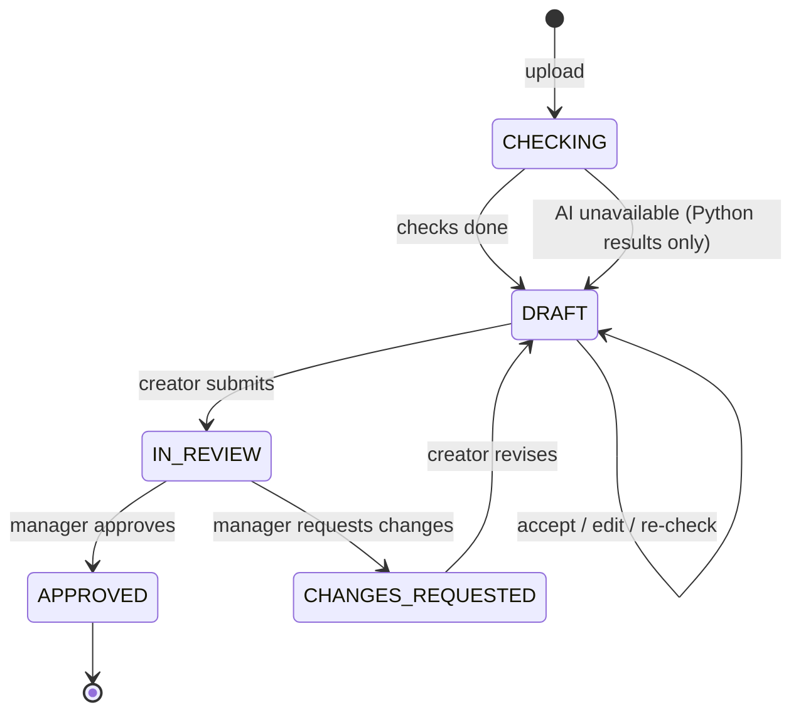
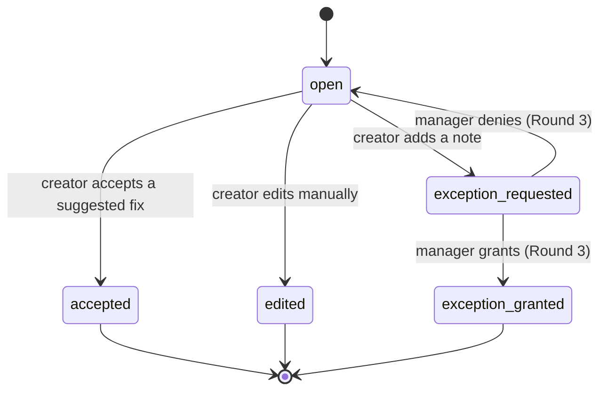
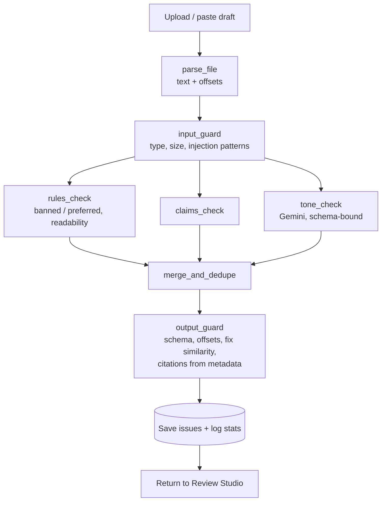
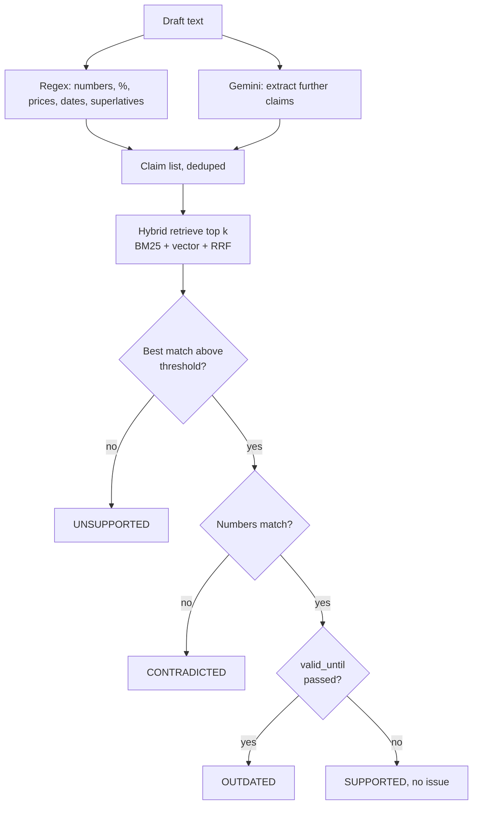

# LoomGuard: Complete Workflow

Covers the product journey, the system pipeline, states, data, failure handling and the demo path. Diagrams use Mermaid, which GitHub renders automatically.

## 1. Actors

| Role | Who | Can do |
|---|---|---|
| **Brand Manager** | Owns the brand kit, reviews drafts | Set up kit, comment, approve / request changes, decide on exceptions, view insights |
| **Creator** | Writer, designer, agency | Upload drafts, fix issues, request exceptions, submit for review |
| **LoomGuard (system)** | Automated checker | Runs checks, cites sources, suggests phrase-level fixes. **Never approves** |

(Compliance reviewer is the same Manager view in Round 2. Splitting the role is a future step.)

## 2. End-to-end product journey

```mermaid
sequenceDiagram
    autonumber
    actor M as Brand Manager
    actor C as Creator
    participant UI as React App
    participant API as FastAPI
    participant AI as Gemini 2.5 Flash
    participant DB as MongoDB + ChromaDB

    M->>UI: Upload Brand Guide PDF + Facts CSV, terms, HEX codes
    UI->>API: POST /brand/upload, PUT /brand/terms
    API->>DB: Chunk PDF (page no.), rows (row id), index; save glossary
    API-->>UI: Brand kit ready (version n)

    C->>UI: Upload or paste draft
    UI->>API: POST /drafts
    API->>API: Parse, input guard
    par Parallel checks
        API->>API: Rules check (Python)
        API->>AI: Extract claims
        API->>DB: Hybrid retrieve + numeric compare
        API->>AI: Tone check (phrase-only schema)
    end
    API->>API: Merge, validate, output guard
    API-->>UI: Issues with citations + fixes + AI/Rule tags

    C->>UI: Accept fix / edit manually / request exception
    UI->>API: PATCH issue
    C->>UI: Submit
    UI->>API: POST submit (DRAFT to IN_REVIEW)

    M->>UI: Open review queue, read exceptions, comment
    M->>UI: Approve or Request Changes
    UI->>API: POST decision
    API->>DB: Log decision, update insights
    API-->>UI: APPROVED or CHANGES_REQUESTED
```

## 3. Draft status flow



Rules:
- A creator can submit with open issues only if each is accepted, edited, or has an exception note.
- Only a Manager can move IN_REVIEW to APPROVED or CHANGES_REQUESTED.
- Editing the text always triggers a re-check before submit.

## 4. Issue lifecycle



In Round 2 the manager sees exception notes and comments on them. The grant/deny workflow is Round 3 improvement 2.

## 5. Brand setup and indexing flow

1. Manager uploads Brand Guide PDF, Approved Facts CSV, terms list and HEX codes.
2. Validate files (type, size, text-based PDF). Reject scanned PDFs with a clear message.
3. PDF: extract per page, split into chunks of about 300 to 500 tokens, store `{text, page_number, section}`.
4. CSV: one record per row `{row_id, claim, value, unit, source, valid_until}`.
5. Index chunks and rows in ChromaDB (embeddings) and a BM25 index.
6. Save glossary (banned, preferred, HEX) in MongoDB.
7. Bump `kit_version`. Drafts record the version they were checked against.

## 6. Draft check pipeline (LangGraph)



### 6a. Claim check detail



Citation = `{doc, page_number | row_id}` from the matched record. Gemini never writes it.

### 6b. Check summary

| Check | Method | Source tag | Needs Gemini |
|---|---|---|---|
| Banned / preferred terms | Fuzzy and exact match | Rule | No |
| Readability | textstat | Rule | No |
| Claim extraction | Regex + Gemini | Rule + AI | Partly |
| Claim verification | Hybrid retrieval + numeric compare | Rule | No |
| Tone and wording | Gemini, phrase-only schema | AI | Yes |

## 7. Guardrails along the path

| Stage | Guard |
|---|---|
| Upload | Type and size limits, scanned-PDF detection |
| Before AI | Draft wrapped in delimiters, injection patterns flagged |
| After AI | Pydantic validation, phrase must exist verbatim, offsets computed by code, replacement length close to original, similarity check |
| Citations | Always from metadata |
| Decisions | Only Manager approves, no auto-approve |
| Failure | 10 s timeout, one retry, Python-only fallback with `ai_available: false` |
| Disclosure | AI / Rule tag on every issue and check |

## 8. Data model (MongoDB)

| Collection | Key fields |
|---|---|
| `brand_kits` | `kit_version`, `terms{banned,preferred}`, `hex_codes[]`, `guide_meta`, `facts_meta` |
| `chunks` | `kit_version`, `type(pdf|csv)`, `text`, `page_number | row_id`, `value`, `valid_until` |
| `drafts` | `id`, `title`, `author`, `text`, `status`, `kit_version`, `content_hash`, `ai_available` |
| `issues` | `draft_id`, `category`, `claim_status`, `severity`, `source`, `quote`, `start`, `end`, `reason`, `citation`, `suggested_fixes[]`, `status`, `exception_note` |
| `comments` | `draft_id`, `author`, `role`, `text`, `issue_id?`, `created_at` |
| `decisions` | `draft_id`, `manager`, `decision`, `comment`, `created_at` |
| `stats` | rolled up from issues for `/insights` |

## 9. API map

| Stage | Endpoint |
|---|---|
| Setup | `POST /api/brand/upload`, `PUT /api/brand/terms`, `GET /api/brand` |
| Check | `POST /api/drafts`, `GET /api/drafts/{id}` |
| Fix | `PATCH /api/drafts/{id}/issues/{iid}`, `POST /api/drafts/{id}/recheck` |
| Review | `POST /api/drafts/{id}/submit`, `POST /api/drafts/{id}/comments`, `POST /api/drafts/{id}/decision` |
| Insights | `GET /api/insights` |
| Health | `GET /api/health` |

## 10. Screens (frontend)

1. **Brand Setup:** uploads, terms, HEX codes, kit status.
2. **Review Studio (split pane):** draft with highlights on the left, issue card on the right (reason, citation, fixes, AI/Rule tag, action buttons).
3. **Review Queue (Manager):** drafts by status, open the review.
4. **Review view (Manager):** draft, issues with exception notes, comments, Approve / Request Changes.
5. **Insights:** issues by category, top triggered rules, exception count.

## 11. Failure and edge cases

| Case | Behavior |
|---|---|
| Gemini timeout / quota | Retry once, return Python results, banner "AI checks unavailable" |
| Invalid Gemini JSON | Drop that item, log it, continue |
| Quote not found in draft | Drop the issue (guard) |
| Scanned or corrupted PDF / DOCX | Clear error, nothing partial saved |
| No brand kit yet | Block draft upload with a link to Brand Setup |
| Very long draft | Chunk for AI calls, merge results |
| Duplicate draft and kit version | Return cached result by hash |
| Server cold start | Frontend shows a loading state, retries health check |

## 12. Evaluation workflow

1. Build golden sets (claims, retrieval pairs, banned-term drafts).
2. `python evals/run_evals.py` writes `evals/results.json` and a markdown table.
3. Re-run after every change to retrieval, thresholds or prompts.
4. Put the latest table in the README and the Round 2 PDF.

## 13. Team workflow

- Pradeep: `frontend/`, `sample_kit/`. Shruthi: `backend/`, `evals/`.
- Contract in `docs/contract.md` is the source of truth. Update it before changing a response shape.
- Mock JSON first, real API wired after.
- `main` stays deployable. Feature branches, small commits, pull before each block.
- Block-by-block schedule is in `ROADMAP.md`.

## 14. Three-minute judge demo

1. Open live link, demo kit already loaded (10 s).
2. Show Brand Setup briefly: guide, facts, terms (20 s).
3. Upload flawed draft. Issues appear in about 15 s (30 s).
4. Click a CONTRADICTED claim: show reason, "Facts CSV Row 14" citation, AI/Rule tag (30 s).
5. Accept one fix (only the phrase changes), request an exception on another (20 s).
6. Submit, switch to Manager, comment, approve (40 s).
7. Show Insights and the eval results table (20 s).
8. Close with the three Round 3 improvements (20 s).
